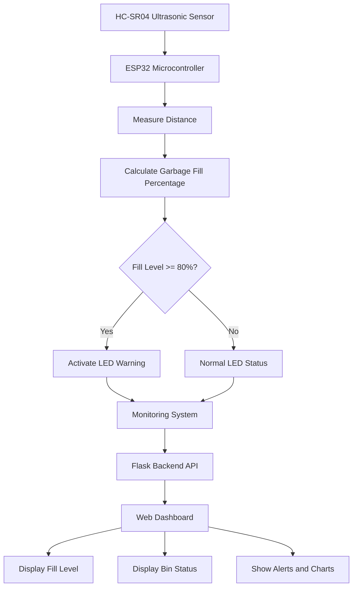

# 🗑️ Smart Garbage Monitoring System

An IoT-based Smart Garbage Monitoring System designed to monitor garbage-bin fill levels using an ESP32 and an ultrasonic sensor. The system calculates the garbage level and displays the monitoring information through a web-based dashboard.

The project aims to make garbage collection more efficient by providing real-time-style bin status visualization, fill-level indicators, and alerts when a garbage bin is almost full.

---

## 📌 Introduction

Traditional garbage collection systems generally follow fixed collection schedules, regardless of whether garbage bins are empty or full. This can lead to overflowing bins, unnecessary collection trips, and inefficient waste management.

The **Smart Garbage Monitoring System** provides a technology-based approach to this problem.

An ultrasonic sensor measures the distance between the sensor and the garbage surface inside the bin. An ESP32 is used to process the sensor readings and calculate the garbage fill percentage.

A web dashboard displays garbage-bin information, including fill percentage, bin status, and alerts.

This project demonstrates how IoT hardware, sensor monitoring, Python backend development, and web technologies can be combined to build a smart waste-monitoring solution.

---

## ✨ Features

- **Ultrasonic Distance Measurement:** Measures the distance between the sensor and garbage surface.
- **Garbage Fill-Level Calculation:** Calculates the bin's fill percentage based on its total depth.
- **ESP32 Integration:** Uses ESP32 as the microcontroller for sensor monitoring.
- **LED Warning Indicator:** Activates an LED when the garbage level reaches the configured threshold.
- **Web-Based Dashboard:** Displays garbage-bin information in an easy-to-understand interface.
- **Bin Status Monitoring:** Displays whether a bin has space, is half full, or is almost full.
- **Full-Bin Alerts:** Identifies bins that reach 80% or higher capacity.
- **Visual Analytics:** Displays garbage fill-level information using charts.
- **Flask Backend:** Provides REST API endpoints for retrieving and updating bin information.
- **Wokwi Simulation:** Supports circuit simulation without requiring physical hardware.

---

## 🛠️ Technology Stack

| Technology | Purpose |
|---|---|
| ESP32 | Microcontroller |
| HC-SR04 Ultrasonic Sensor | Measures garbage level |
| C++ | ESP32 programming |
| HTML5 | Dashboard structure |
| CSS3 | Dashboard styling |
| JavaScript | Dashboard functionality |
| Python | Backend development |
| Flask | REST API |
| Chart.js | Data visualization |
| Wokwi | IoT circuit simulation |
| Git & GitHub | Version control and project hosting |

---

## 🏗️ System Architecture

The system consists of three main components:

1. **Hardware Layer:** ESP32 and HC-SR04 ultrasonic sensor.
2. **Backend Layer:** Python Flask application that provides API endpoints and manages bin information.
3. **Frontend Layer:** Web dashboard that displays bin fill levels, status, alerts, and charts.

### System Flow Diagram



**Note:** The diagram represents the intended system architecture. In the current prototype, the Flask backend uses simulated bin readings. Live ESP32-to-Flask communication has not yet been implemented.

---

## 📊 Dashboard

The web dashboard provides a visual overview of garbage-bin monitoring information.

### Dashboard Features

- Overview of monitored garbage bins.
- Individual bin fill-level indicators.
- Visual representation of bin status.
- Almost-full garbage-bin alerts.
- Fill-level history chart.
- Demo controls for simulating garbage-bin fill levels.

### Dashboard Access

**Local Dashboard:**

[http://127.0.0.1:5000/](http://127.0.0.1:5000/)

The local dashboard is accessible when the Flask application is running on your computer.

**Online Dashboard:** Not deployed yet.

---

## 📸 Screenshots

### 1. Wokwi Circuit Simulation


### 2. Smart Garbage Monitoring Dashboard


### 3. Full Garbage Bin Alert


---

## 📁 Project Structure

```text
smart-garbage-monitoring-system/
│
├── app.py
├── index.html
├── requirements.txt
├── README.md
│
├── static/
│   └── app.js
│
└── screenshots/
    ├── wokwi-circuit.png
    ├── dashboard.png
    └── full-bin-alert.png
```

---

## ⚙️ Installation and Setup

Follow these steps to run the project locally.

### Prerequisites

- Python 3.x
- Visual Studio Code
- Git
- Web browser

### Step 1: Clone the Repository

```bash
git clone https://github.com/YOUR_USERNAME/smart-garbage-monitoring-system.git
```

### Step 2: Navigate to the Project Directory

```bash
cd smart-garbage-monitoring-system
```

### Step 3: Create a Virtual Environment

```bash
python -m venv .venv
```

### Step 4: Activate the Virtual Environment

For Windows PowerShell:

```powershell
.\.venv\Scripts\Activate.ps1
```

### Step 5: Install Dependencies

```bash
pip install -r requirements.txt
```

If you do not have a requirements file, install Flask:

```bash
pip install flask
```

### Step 6: Start the Flask Application

```bash
python app.py
```

### Step 7: Open the Dashboard

Open your browser and visit:

```text
http://127.0.0.1:5000/
```

The Smart Garbage Monitoring dashboard should now be accessible.

---

## 🔌 Hardware Components

| Component | Description |
|---|---|
| ESP32 DevKit | Main controller |
| HC-SR04 | Ultrasonic distance sensor |
| LED | Visual warning indicator |
| 220Ω Resistor | LED current limiting |
| Jumper Wires | Circuit connections |

The circuit is currently implemented and tested using the Wokwi simulator.

---

## 🧮 Garbage Fill-Level Calculation

The garbage fill percentage is calculated using the following formula:

```text
Fill Level (%) = ((Bin Depth - Measured Distance) / Bin Depth) × 100
```

For example:

```text
Bin Depth = 40 cm
Measured Distance = 10 cm

Fill Level = ((40 - 10) / 40) × 100

Fill Level = 75%
```

### Bin Status Conditions

| Fill Percentage | Bin Status |
|---|---|
| Below 50% | Has Space |
| 50% – 79% | Half Full |
| 80% – 100% | Almost Full |

When the fill level reaches 80% or higher, the LED warning indicator is activated.

---

## 🚀 Future Enhancements

The following improvements can be implemented in future versions:

- **Live ESP32 Integration:** Connect the ESP32 directly to the Flask backend to transmit actual sensor readings.
- **Database Integration:** Store garbage-bin readings and maintain historical records.
- **Cloud Deployment:** Deploy the dashboard online for remote monitoring.
- **Multiple Bin Monitoring:** Support multiple garbage bins across different locations.
- **Mobile-Friendly Interface:** Improve dashboard accessibility on smartphones and tablets.
- **Smart Notifications:** Send notifications when garbage bins reach their maximum capacity.
- **Collection Optimization:** Help optimize garbage collection schedules based on bin fill levels.
- **Data Analytics:** Generate reports and analyze garbage collection patterns.

---

## ⚠️ Current Project Limitations

- The hardware circuit is currently simulated using Wokwi.
- The Flask backend currently uses simulated garbage-bin readings.
- Live communication between the ESP32 and Flask backend is not implemented.
- Historical readings are maintained in browser memory and are not permanently stored.
- The dashboard currently runs locally and has not been deployed online.

---

## 🎯 Project Objective

The primary objective of this project is to demonstrate how IoT technology and web-based monitoring can contribute to smarter waste management.

By monitoring garbage-bin fill levels and identifying bins that require attention, the system provides a foundation for more efficient and intelligent garbage collection.

---

## 👨‍💻 Author

**Your Name**

GitHub: 

---

⭐ If you find this project interesting, consider giving the repository a star!
