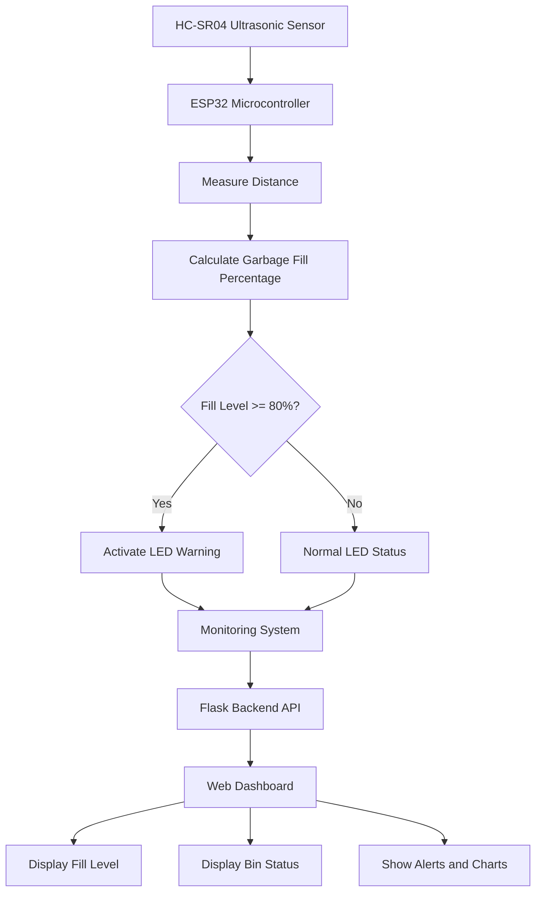

# 🗑️ Smart Garbage Monitoring System

An IoT-based Smart Garbage Monitoring System that monitors garbage-bin fill levels using an ESP32 microcontroller and an HC-SR04 ultrasonic sensor. The system calculates the garbage fill percentage and displays monitoring information through a web-based dashboard.

The project aims to improve waste management by identifying garbage bins that are almost full, helping reduce overflowing bins and supporting more efficient garbage collection.

---

## 📌 1. Introduction

Traditional garbage collection systems generally follow fixed collection schedules, regardless of whether garbage bins are empty or full. This can result in overflowing bins, unnecessary collection trips, and inefficient waste management.

To address this problem, the **Smart Garbage Monitoring System** provides a technology-based approach to monitoring garbage-bin levels.

The system uses an HC-SR04 ultrasonic sensor to measure the distance between the sensor and the garbage surface inside the bin. An ESP32 microcontroller processes the sensor readings and calculates the garbage fill percentage.

A web-based dashboard displays garbage-bin information, including fill percentage, bin status, and alerts when a bin reaches the configured capacity threshold.

This project demonstrates how IoT hardware, sensor monitoring, Python backend development, and web technologies can be combined to build a smart waste-monitoring solution.

---

## 🎯 2. Project Objectives

- Monitor garbage-bin fill levels using an ultrasonic sensor.
- Calculate garbage fill percentage based on measured distance.
- Identify bins that are almost full.
- Activate an LED warning indicator when the bin reaches 80% capacity.
- Display garbage-bin information through a web dashboard.
- Provide a foundation for more efficient and intelligent waste management.

---

## ✨ 3. Features

- **Ultrasonic Distance Measurement:** Measures the distance between the sensor and the garbage surface.
- **ESP32 Integration:** Uses ESP32 as the microcontroller for sensor monitoring.
- **Garbage Fill-Level Calculation:** Calculates the bin's fill percentage based on its total depth.
- **LED Warning Indicator:** Activates an LED when the garbage level reaches 80% or higher.
- **Web-Based Dashboard:** Displays garbage-bin information through a simple interface.
- **Bin Status Monitoring:** Displays whether a bin has space, is half full, or is almost full.
- **Full-Bin Alerts:** Identifies bins that reach the configured 80% threshold.
- **Visual Analytics:** Displays fill-level information using charts.
- **Flask Backend:** Provides REST API endpoints for retrieving and updating bin information.
- **Wokwi Simulation:** Supports circuit simulation without requiring physical hardware.

---

## 🛠️ 4. Technology Stack

| Technology | Purpose |
|---|---|
| ESP32 DevKit | Main microcontroller |
| HC-SR04 Ultrasonic Sensor | Measures garbage level |
| C++ | ESP32 firmware programming |
| Wokwi | IoT circuit simulation |
| HTML5 | Dashboard structure |
| CSS3 | Dashboard styling |
| JavaScript | Dashboard functionality |
| Python | Backend development |
| Flask | REST API development |
| Chart.js | Data visualization |
| Git & GitHub | Version control and project hosting |

---

## 🔌 5. Hardware Components

| Component | Description |
|---|---|
| ESP32 DevKit | Main controller |
| HC-SR04 Ultrasonic Sensor | Measures distance to the garbage surface |
| Red LED | Visual warning indicator |
| 220Ω Resistor | Limits current flowing through the LED |
| Jumper Wires | Circuit connections |

The hardware circuit is currently implemented and tested using the Wokwi simulator.

---

## 📡 6. HC-SR04 Ultrasonic Sensor – Working Principle

The HC-SR04 is an ultrasonic distance-measuring sensor used to measure the distance between the sensor and an object without physical contact.

In this project, the sensor is placed at the top of the garbage bin to measure the empty space between the sensor and the garbage surface.

### Sensor Pins

The HC-SR04 has four pins:

| Pin | Description |
|---|---|
| VCC | Provides 5V power supply |
| GND | Ground connection |
| TRIG | Triggers the ultrasonic pulse |
| ECHO | Returns the signal duration |

### How Does It Work?

The sensor works using ultrasonic sound waves and follows these steps:

1. **Trigger Signal:** The ESP32 sends a HIGH pulse to the TRIG pin for approximately 10 microseconds.
2. **Ultrasonic Transmission:** The sensor generates ultrasonic sound waves at approximately 40 kHz.
3. **Reflection:** The sound waves travel towards the garbage surface and bounce back after hitting it.
4. **Echo Reception:** The ECHO pin produces a HIGH signal for the time taken by the sound waves to travel to the object and return.
5. **Distance Calculation:** The ESP32 measures the duration of the ECHO signal and calculates the distance.

### Distance Calculation Formula

The distance is calculated using:

```text
Distance = (Time × Speed of Sound) / 2
```

Where:

- Time = Duration of the ECHO signal.
- Speed of sound = Approximately 0.0343 cm/µs.
- Division by 2 accounts for the sound travelling to the object and returning.

### Distance Calculation Example

Suppose the ECHO signal duration is 583 microseconds.

```text
Distance = (583 × 0.0343) / 2

Distance ≈ 10 cm
```

Therefore, the garbage surface is approximately 10 cm below the sensor.

### Sensor Connections with ESP32

| HC-SR04 Pin | ESP32 Pin |
|---|---|
| VCC | VIN |
| GND | GND |
| TRIG | GPIO 5 |
| ECHO | GPIO 18 |

**Hardware note:** The HC-SR04 ECHO output is typically 5V. When using a physical ESP32, use an appropriate voltage divider or level shifter to reduce the ECHO signal to a safe 3.3V GPIO level. The Wokwi circuit is a simulation.

---

## 🧮 7. Garbage Fill-Level Calculation

The garbage fill percentage is calculated using the total depth of the bin and the distance measured by the ultrasonic sensor.

In this project, the configured bin depth is **40 cm**.

### Formula

```text
Fill Level (%) =
((Bin Depth - Measured Distance) / Bin Depth) × 100
```

### Example

Suppose:

```text
Bin Depth = 40 cm
Measured Distance = 10 cm
```

Calculation:

```text
Fill Level = ((40 - 10) / 40) × 100

Fill Level = 75%
```

The garbage bin is therefore 75% full.

### Fill-Level Examples

| Sensor Distance | Garbage Fill Level | Bin Status |
|---|---:|---|
| 35 cm | 12.5% | Has Space |
| 25 cm | 37.5% | Has Space |
| 20 cm | 50% | Half Full |
| 10 cm | 75% | Half Full |
| 5 cm | 87.5% | Almost Full |
| 2 cm | 95% | Almost Full |

### Bin Status Conditions

| Fill Percentage | Bin Status |
|---|---|
| Below 50% | Has Space |
| 50% – 79% | Half Full |
| 80% – 100% | Almost Full |

When the fill level reaches 80% or higher, the LED warning indicator is activated.

---

## 🏗️ 8. System Architecture

The system consists of three main components:

1. **Hardware Layer:** ESP32 and HC-SR04 ultrasonic sensor.
2. **Backend Layer:** Python Flask application that manages bin information and provides REST API endpoints.
3. **Frontend Layer:** Web dashboard that displays bin fill levels, status, alerts, and charts.

### System Flow Diagram



**Implementation note:** This diagram represents the intended end-to-end architecture. In the current prototype, the Wokwi hardware simulation and Flask dashboard operate separately. The Flask backend currently uses simulated bin readings rather than receiving live ESP32 sensor data.

---

## ⚙️ 9. Backend – Python Flask

The backend is developed using Python and Flask.

Flask acts as the backend application and provides REST API endpoints for retrieving and updating garbage-bin information.

The current prototype maintains two garbage-bin records:

- BIN-01
- BIN-02

### API 1: Retrieve All Garbage Bins

**Endpoint:**

```http
GET /api/bins
```

This API retrieves the fill level, status, and sensor distance information for all available bins.

**Example Response:**

```json
{
  "bins": [
    {
      "device_id": "BIN-01",
      "fill_level": 35.0,
      "status": "Has Space",
      "sensor_distance_cm": 26.0
    },
    {
      "device_id": "BIN-02",
      "fill_level": 85.0,
      "status": "Almost Full",
      "sensor_distance_cm": 6.0
    }
  ],
  "updated_at": "2026-11-12T12:00:00+00:00"
}
```

### API 2: Update Garbage Bin Information

**Endpoint:**

```http
POST /api/bins/<bin_id>
```

This API updates the fill level of a particular garbage bin.

**Example Request:**

```http
POST /api/bins/BIN-01
```

**Request Body:**

```json
{
  "fill_level": 90
}
```

The backend updates the fill level and calculates the corresponding bin status.

If the fill level reaches 80% or higher, the bin status becomes `Almost Full`.

The backend also validates the fill percentage to ensure that it is a number between 0 and 100.

---

## 📊 10. Web Dashboard

The web dashboard is developed using HTML, CSS, and JavaScript.

It provides a visual overview of garbage-bin monitoring information.

### Dashboard Features

- Overview of monitored garbage bins.
- Individual bin fill-level indicators.
- Visual representation of bin status.
- Almost-full garbage-bin alerts.
- Fill-level history chart using Chart.js.
- Demo controls for simulating garbage-bin fill levels.
- Reset option for restoring demo values.

### Dashboard Access

**Local Dashboard:**

[Open Smart Garbage Monitoring Dashboard](http://127.0.0.1:5000/)

The dashboard is accessible when the Flask application is running on your computer.

**Online Dashboard:** Not deployed yet.

---

## 📸 11. Project Screenshots

### Wokwi Circuit Simulation


### Smart Garbage Monitoring Dashboard


### Full Garbage Bin Alert


---

## 📁 12. Project Structure

```text
smart-garbage-monitoring-system/
│
├── app.py
├── index.html
├── requirements.txt
├── README.md
│
├── static/
│   └── app.js
│
└── screenshots/
    ├── wokwi-circuit.png
    ├── dashboard.png
    └── full-bin-alert.png
```

---

## 🚀 13. Installation and Setup

Follow these steps to run the project locally.

### Prerequisites

- Python 3.x
- Visual Studio Code
- Git
- Web browser

### Step 1: Clone the Repository

```bash
git clone https://github.com/YOUR_USERNAME/smart-garbage-monitoring-system.git
```

### Step 2: Navigate to the Project Directory

```bash
cd smart-garbage-monitoring-system
```

### Step 3: Create a Virtual Environment

```bash
python -m venv .venv
```

### Step 4: Activate the Virtual Environment

For Windows PowerShell:

```powershell
.\.venv\Scripts\Activate.ps1
```

### Step 5: Install Dependencies

```bash
pip install -r requirements.txt
```

If you do not have a requirements file, install Flask:

```bash
pip install flask
```

### Step 6: Start the Flask Application

```bash
python app.py
```

### Step 7: Open the Dashboard

Open your browser and visit:

```text
http://127.0.0.1:5000/
```

The Smart Garbage Monitoring dashboard should now be accessible.

---

## 🧪 14. Testing and Validation

The project was tested using the Wokwi simulator and a locally running Flask application.

### Hardware Testing

- Created the ESP32 circuit using Wokwi.
- Connected the HC-SR04 ultrasonic sensor.
- Tested different sensor distances.
- Verified garbage fill-level calculations.
- Checked LED activation at the 80% threshold.

### Backend Testing

- Started the Flask application locally.
- Tested the GET API for retrieving bin information.
- Tested the POST API for updating garbage-bin fill levels.
- Verified bin status calculations.
- Checked input validation for fill percentages.

### Dashboard Testing

- Verified garbage-bin information display.
- Tested fill-level indicators.
- Checked almost-full alerts.
- Tested dashboard simulation controls.
- Verified chart updates.

---

## 💡 15. Challenges and Learnings

During development, I worked on understanding and implementing different hardware and software components.

### Challenges

**1. Understanding Ultrasonic Distance Measurement**

Understanding how the ultrasonic sensor uses TRIG and ECHO signals to measure distance was an important part of the hardware implementation.

**2. Calculating Garbage Fill Percentage**

The sensor measures the empty distance rather than the garbage percentage directly. I implemented a mathematical formula using the total bin depth and measured distance to calculate the fill level.

**3. Frontend and Backend Integration**

I used Flask REST APIs to retrieve and update bin information and JavaScript to display the information on the dashboard.

### Key Learnings

- Working with ESP32 microcontrollers.
- Understanding ultrasonic sensors and GPIO pins.
- Implementing distance measurement using sound-wave reflection.
- Writing C++ firmware for ESP32.
- Developing REST APIs using Python Flask.
- Connecting frontend applications with backend APIs.
- Building a web dashboard using HTML, CSS, and JavaScript.
- Simulating IoT hardware using Wokwi.

---

## ⚠️ 16. Current Project Limitations

- The hardware circuit is currently simulated using Wokwi.
- The Flask backend currently uses simulated garbage-bin readings.
- Live communication between the ESP32 and Flask backend has not yet been implemented.
- Historical readings are maintained in browser memory and are not permanently stored.
- The dashboard currently runs locally and has not been deployed online.

---

## 🔮 17. Future Enhancements

The following improvements can be implemented in future versions:

- **Live ESP32 Integration:** Connect the ESP32 directly to the Flask backend to transmit actual sensor readings.
- **Database Integration:** Use MySQL or MongoDB to store garbage-bin readings and maintain historical records.
- **Cloud Deployment:** Deploy the dashboard online for remote monitoring.
- **Multiple Bin Monitoring:** Support multiple garbage bins across different locations.
- **Mobile-Friendly Interface:** Improve dashboard accessibility on smartphones and tablets.
- **Smart Notifications:** Send notifications when garbage bins reach their maximum capacity.
- **Collection Optimization:** Help optimize garbage collection schedules based on bin fill levels.
- **Data Analytics:** Generate reports and analyze garbage collection patterns.

---

## 🎯 18. Project Objective

The primary objective of this project is to demonstrate how IoT technology and web-based monitoring can contribute to smarter waste management.

By monitoring garbage-bin fill levels and identifying bins that require attention, the system provides a foundation for more efficient and intelligent garbage collection.

---

## 👨‍💻 19. Author

**Your Name**

GitHub: [Your GitHub Profile](https://github.com/YOUR_USERNAME)

---

⭐ If you find this project interesting, consider giving the repository a star!
